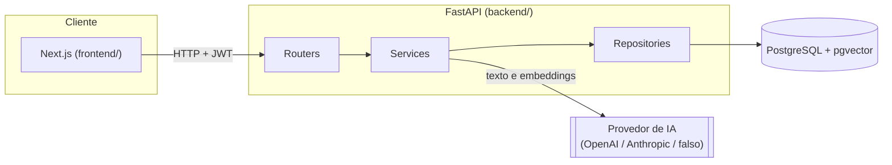

# Assistente de Estudos ADS

Aplicação web para estudantes organizarem disciplinas, prazos e materiais de estudo, com ajuda de IA para resumir conteúdo, responder perguntas, gerar simulados e agendar revisões.

## Problema que resolve

Quem estuda para provas de faculdade costuma espalhar informação em vários lugares: prazos de trabalho e prova numa agenda, PDFs e resumos soltos no computador, e nenhum lembrete de quando revisar o que já foi estudado. O Assistente de Estudos junta isso em um só lugar e usa IA para extrair valor dos materiais que o estudante já tem (perguntar sobre eles, resumir, gerar questões de prática) e para lembrar o estudante de revisar no momento certo, antes da prova.

## Funcionalidades

- **Conta e login**: cadastro e autenticação por e-mail/senha (token JWT).
- **Disciplinas**: criar, editar e excluir disciplinas, cada uma com uma cor para identificação visual.
- **Prazos**: provas e trabalhos por disciplina, com data e status de conclusão.
- **Materiais**: upload de PDF ou texto por disciplina (até 10 MB). O material é dividido em trechos e indexado com embeddings para busca por similaridade.
- **Perguntas sobre o material**: pergunta em linguagem natural, resposta gerada a partir dos trechos mais relevantes, com as citações (página e trecho) usadas na resposta. Quando nada relevante é encontrado, o sistema responde isso claramente em vez de inventar uma resposta.
- **Resumo**: gera um resumo em tópicos do material, a partir do conteúdo extraído.
- **Simulados**: gera um simulado de múltipla escolha (1 a 20 questões) a partir do material, sem mostrar o gabarito; ao corrigir, retorna nota, acertos e, por questão, a alternativa correta, se o estudante acertou e uma explicação.
- **Revisões por repetição espaçada**: depois que um material fica pronto, o sistema agenda revisões automaticamente (1, 3, 7, 14, 30 dias), ajustando os intervalos para nunca passar da data da próxima prova da disciplina. A cada revisão concluída, o estudante informa se lembrou, achou difícil ou esqueceu, e a próxima data é recalculada.
- **Painel**: visão geral com os próximos prazos (destacando a prova mais próxima), as revisões do dia e o desempenho nos últimos simulados.
- **Limite diário de IA**: cada usuário tem uma cota diária de chamadas de IA (resumo, perguntas e simulados); ao estourar, a API responde com erro 429 e uma mensagem amigável.

## Capturas de tela

As imagens de demonstração ficam em [`docs/prints/`](docs/prints/). Ainda não foram adicionadas — os nomes abaixo são os esperados quando alguém for capturá-las:

| Arquivo | Tela |
|---|---|
| `docs/prints/painel.png` | Painel inicial |
| `docs/prints/material-chat.png` | Chat de perguntas sobre um material |
| `docs/prints/simulado.png` | Simulado e resultado da correção |
| `docs/prints/revisoes.png` | Calendário de revisões |

## Arquitetura

O front-end (Next.js) conversa com a API (FastAPI) por HTTP, enviando o token JWT em cada requisição autenticada. A API é organizada em camadas: os **routers** recebem a requisição e validam o formato de entrada/saída, os **services** concentram as regras de negócio, e os **repositories** são os únicos que conversam com o banco. Os serviços que precisam de IA (resumo, perguntas, simulado) chamam um provedor de IA escolhido por configuração.



## Modelo de dados (resumido)

| Entidade | Principais campos | Relação |
|---|---|---|
| `usuarios` | nome, email, senha (hash) | — |
| `disciplinas` | nome, professor, cor | pertence a um usuário |
| `prazos` | titulo, tipo (prova/trabalho), data, concluido | pertence a uma disciplina |
| `materiais` | titulo, tipo (pdf/texto), status (processando/pronto/erro), resumo | pertence a uma disciplina |
| `trechos` | conteudo, pagina, posicao, embedding (vetor) | pertence a um material |
| `simulados` | criado_em, nota, corrigido_em | pertence a um material |
| `questoes` | enunciado, alternativas, correta, explicacao, trecho_id | pertence a um simulado |
| `respostas_simulado` | alternativa_escolhida, acertou | pertence a uma questão |
| `revisoes` | data_prevista, etapa, status (pendente/feita/pulada) | pertence a um material |
| `uso_ia` | usuario_id, data, contagem | contador diário por usuário |

A coluna `embedding` de `trechos` usa o tipo `vector` do **pgvector**, e as buscas por similaridade usam distância de cosseno.

## Como rodar com Docker Compose

Requer Docker e Docker Compose.

```bash
cp .env.example .env
docker compose up --build
```

Isso sobe três serviços:

- **postgres** — PostgreSQL com a extensão pgvector, na porta `5432` (ou `POSTGRES_PORT_HOST`, se definida no `.env`).
- **backend** — API FastAPI, em `http://localhost:8000` (ou `BACKEND_PORT_HOST`).
- **frontend** — aplicação Next.js, em `http://localhost:3000` (ou `FRONTEND_PORT_HOST`).

Teste se a API está de pé com:

```bash
curl http://localhost:8000/saude
```

## Testes e lint

### Backend

```bash
cd backend
pip install -e ".[dev]"
ruff check .
alembic upgrade head
pytest
```

Os testes usam `DATABASE_URL` (ou `TEST_DATABASE_URL`, se definida) para criar e limpar as tabelas automaticamente — não é preciso banco de dados separado além de um PostgreSQL com pgvector acessível. O CI (`.github/workflows/ci.yml`) roda lint, migrações e testes a cada push/PR.

### Frontend

```bash
cd frontend
npm install
npm run lint
npm run build
```

Ainda não há suíte de testes automatizados no frontend (ver "Próximos passos").

## Variáveis de ambiente

Definidas em `.env` (veja `.env.example`; nenhum valor real de segredo é versionado).

| Variável | Para quê serve | Observação |
|---|---|---|
| `DATABASE_URL` | Conexão do backend com o PostgreSQL | formato `postgresql+asyncpg://...` |
| `POSTGRES_USER` / `POSTGRES_PASSWORD` / `POSTGRES_DB` | Credenciais do container do PostgreSQL | usadas pelo `docker-compose.yml` |
| `JWT_SECRET` | Chave usada para assinar e validar o token de login | use um valor longo e aleatório em produção |
| `IA_PROVEDOR` | Provedor de IA para texto (resumo, perguntas, simulado) | `openai`, `anthropic` ou `falso` (determinístico, usado em testes) |
| `IA_API_KEY` | Chave de API do provedor de IA escolhido | não versionar o valor real |
| `EMBEDDING_PROVEDOR` | Provedor usado para gerar embeddings dos trechos | `openai` ou `falso` (Anthropic não oferece embeddings) |
| `EMBEDDING_DIM` | Dimensão do vetor de embedding | precisa combinar com o provedor escolhido |
| `AMBIENTE` | Ambiente de execução (`development`, etc.) | informativo |
| `NEXT_PUBLIC_API_URL` | URL da API que o frontend chama no navegador | precisa ser acessível pelo navegador do usuário, não só pela rede interna do Docker |
| `POSTGRES_PORT_HOST` / `BACKEND_PORT_HOST` / `FRONTEND_PORT_HOST` | Portas expostas na máquina host pelo `docker-compose.yml` | opcionais, têm padrão (5432, 8000, 3000) |

Outras configurações têm valor padrão no código (`backend/app/config.py`) e também podem ser sobrepostas por variável de ambiente, se necessário: `TAMANHO_TRECHO`, `SOBREPOSICAO_TRECHO`, `TOP_K_BUSCA`, `LIMIAR_SIMILARIDADE`, `TAMANHO_MAXIMO_ARQUIVO_MB`, `LIMITE_IA_DIARIO`.

## Decisões técnicas

- **Arquitetura em camadas** (`routers` → `services` → `repositories` → `models`): cada router só traduz HTTP ↔ chamada de serviço; regra de negócio fica nos serviços; acesso a dados fica isolado nos repositórios. Isso mantém os routers finos e facilita testar a regra de negócio sem precisar de uma requisição HTTP de verdade.
- **pgvector para busca semântica**: cada material é dividido em trechos (com sobreposição entre eles, para não cortar uma ideia no meio) e cada trecho vira um vetor de embedding, guardado na própria tabela `trechos` com o tipo `vector`. A pergunta do usuário também é transformada em vetor e comparada por distância de cosseno direto no PostgreSQL, sem precisar de um banco de vetores separado.
- **Citações e "não encontrei" sem gastar chamada de LLM**: antes de pedir uma resposta ao modelo de texto, o sistema mede a similaridade do trecho mais próximo. Se estiver abaixo de um limiar configurável (`LIMIAR_SIMILARIDADE`), ele responde "não encontrei isso no material" direto, sem citações e sem chamar o LLM — economiza custo e evita o modelo "inventar" uma resposta sobre algo que não está no material.
- **Repetição espaçada limitada pela prova**: os intervalos de revisão seguem a progressão 1 → 3 → 7 → 14 → 30 dias (avançando quando o estudante lembra, repetindo a mesma etapa quando achou difícil, e voltando para o início quando esqueceu). Se a disciplina tem uma prova marcada, nenhuma revisão é agendada depois dela — o intervalo é encurtado para caber antes da prova. Quando a data da prova muda, as revisões pendentes daquela disciplina são reencaixadas.
- **Limite de IA por usuário**: cada chamada que usa IA (resumo, pergunta ou geração de simulado) incrementa um contador diário por usuário (tabela `uso_ia`). Ao passar do limite (`LIMITE_IA_DIARIO`, padrão 20/dia), a API responde `429` com `{"erro": "..."}`.
- **Provedor de IA configurável**: a escolha do provedor (OpenAI, Anthropic ou um provedor "falso" determinístico, usado em testes automatizados) é feita por uma fábrica a partir de `IA_PROVEDOR`/`EMBEDDING_PROVEDOR`, sem acoplar o resto do sistema a um SDK específico.
- **Uploads limitados a 10 MB**: o tamanho do arquivo é validado no servidor antes de processar (e também no cliente, para dar feedback mais rápido). Apenas PDF e texto puro são aceitos; qualquer outro tipo ou um arquivo acima do limite retorna erro (415 ou 413) antes de consumir qualquer chamada de IA.

## Deploy sugerido

O projeto não tem configuração de deploy versionada ainda; a sugestão abaixo é um caminho razoável dado como ele está montado hoje:

- **Backend + PostgreSQL**: Railway ou Render, usando uma imagem com extensão pgvector (ex. `pgvector/pgvector`) para o banco, e o `backend/Dockerfile` existente para a API. Configurar as variáveis de ambiente listadas acima direto na plataforma (nunca commitar `IA_API_KEY`/`JWT_SECRET`).
- **Frontend**: Vercel, apontando para o repositório com a raiz do projeto em `frontend/`, configurando `NEXT_PUBLIC_API_URL` para a URL pública do backend.
- Como o front e o back podem acabar em domínios diferentes, vale revisar CORS no backend antes de ir para produção (hoje o foco foi o ambiente local via Docker Compose).

## Próximos passos

- Testes automatizados para simulados, revisões e painel (hoje a suíte cobre autenticação, disciplinas, prazos, materiais, perguntas e resumo).
- Suíte de testes no frontend e um job de CI para lint/build do `frontend/` (o CI atual só roda o backend).
- Configuração de CORS e de deploy (Dockerfile de produção do frontend, variáveis por ambiente) para rodar fora do Docker Compose local.
- Capturar as imagens de `docs/prints/` listadas acima.

## Estrutura do projeto

```
backend/
  app/
    main.py          # criação da aplicação (create_app)
    config.py        # configurações via pydantic-settings
    database.py      # engine e sessão assíncrona
    dependencies.py  # dependências injetáveis (sessão, usuário atual, repositórios, limite de IA)
    models/          # modelos SQLAlchemy
    schemas/         # schemas Pydantic (request/response)
    repositories/     # acesso a dados
    services/         # regras de negócio
    routers/          # endpoints HTTP
    ia/               # provedores de IA (OpenAI, Anthropic, falso) e fábrica
    core/             # utilidades transversais (erros, segurança/JWT)
  alembic/            # migrações do banco
  tests/              # testes automatizados (pytest)
frontend/
  src/
    app/              # páginas (Next.js App Router)
    components/       # componentes de UI
    lib/              # cliente de API, contexto de autenticação, helpers
docs/
  prints/             # capturas de tela de demonstração
```
